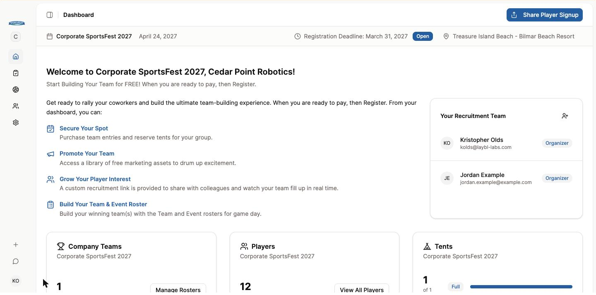
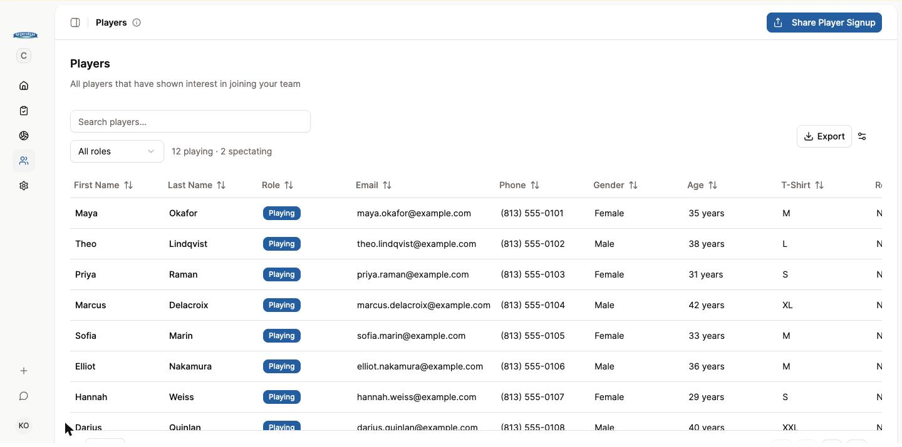
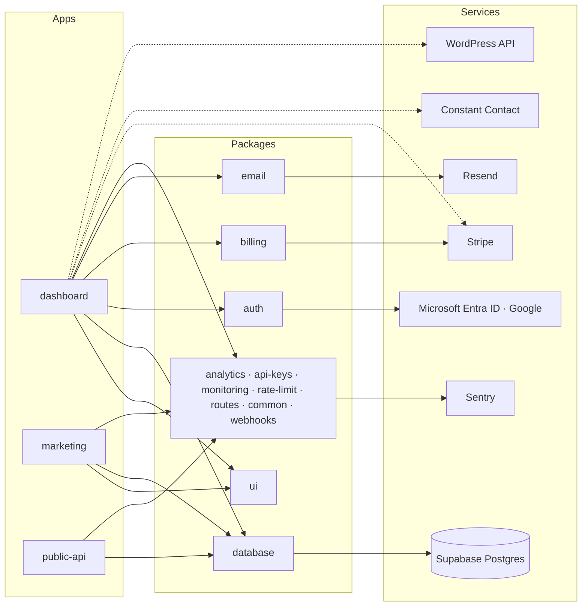
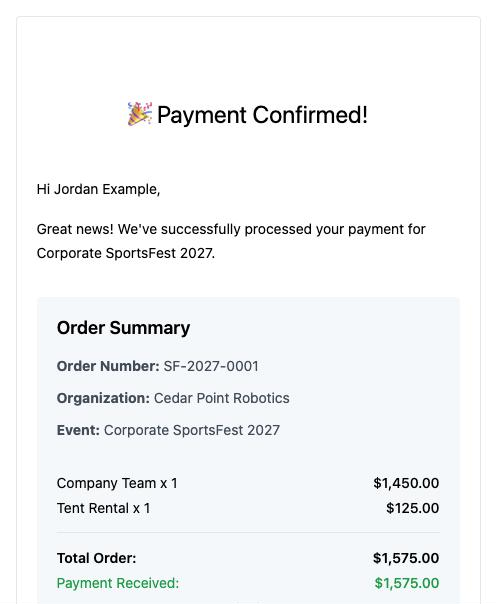
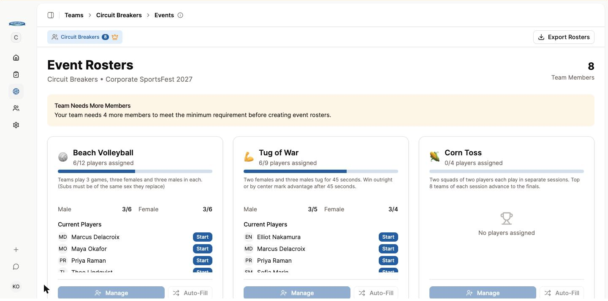
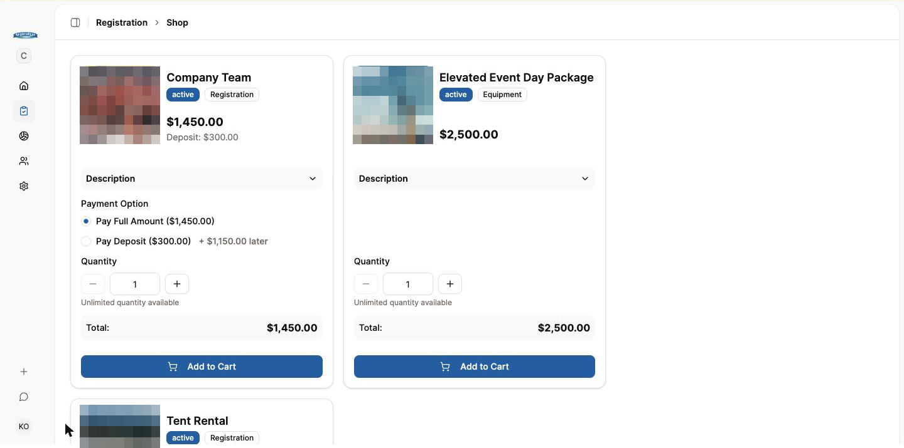

# SportsFest Platform

One platform replaced a patchwork of event software, WordPress plugins, and PDFs, so a 3,000-player corporate beach event could run itself.

This repository is a case study with a curated set of real, scrubbed source files. The product itself is private and client-owned. Screenshots were taken on a development environment against a fictional organization, Cedar Point Robotics, with invented players and organizers; the 2027 products and prices shown are the real public price list, and product photos are pixelated. See [About the code folder](#about-the-code-folder) for what is and is not here.

- Live: [sportsfest.com](https://sportsfest.com) and the signup site at [join.sportsfest.com](https://join.sportsfest.com)
- Built by Kris Olds at LAYBL Labs, August to December 2025, maintained since
- Stack: Next.js 15 (App Router), TypeScript, Turborepo + pnpm, Drizzle ORM on Supabase Postgres, Auth.js, Stripe, Resend + React Email, Sentry, Vercel

## The brief

Florida Corporate SportsFest is an annual corporate team-building event on the beach. Companies buy team slots, recruit players from their offices, and show up to compete in beach volleyball, tug-of-war, corn toss, dodgeball, and a relay.

Before this project, the hosts ran registration through a third-party sports event system bolted onto WordPress plugins. Company organizers recruited coworkers with PDF flyers. Nothing talked to anything else: messaging to participants was inconsistent, the hosts had no clean view of who had signed up or what each company had bought, and the pieces that make SportsFest feel simple did not exist anywhere.

They needed it fixed before the next registration cycle. The build was signed off in late August 2025 and registration had to open in December, which gave three months to replace the whole stack. It opened on time, the April 2026 event sold out by March, and 2027 registration opened the week after the 2026 event ended.

Three kinds of people use it:

- **The hosts**, who manage event years, pricing, sponsors, payments, and reporting from the admin area.
- **Company organizers**, who buy team slots, recruit coworkers, and build team and event rosters.
- **Players**, who sign up through their company's link and pick the events they want to play.

## What was built

| Admin area | Organizer dashboard | Public signup |
| --- | --- | --- |
| Event year management: each year's dates, pricing, and products in one place | Shop and checkout through Stripe, with order and invoice views | Branded signup page for each organization |
| Products for team registration, tents, and equipment, with inventory | Deposit now, pay the balance later | Event interest ranking at signup |
| Coupons for sponsors and discounted pricing | Card and ACH payments, so sponsors can settle large invoices by bank transfer | Playing or spectating role |
| Sponsorship invoices with secure payment links | Recruitment tools hub with share-by-link, QR code, and email | Notification email to the organizer on each signup |
| Payment and invoice management, pending through refunded | Player tables with filters and CSV, Excel, and PDF exports | |
| Tent tracking with availability and purchase detail | Team roster builder driven by the interests players chose | |
| Organization, user, and player management across every company | Event roster builder for each team across all five beach events | |
| Game day reports and revenue, growth, and participation analytics | Organization branding with a custom logo on the signup page | |
| "View as" any organization to answer support questions | Nine short embedded training videos | |

## Architecture

The full diagram, one paragraph per package, and the dashboard's rendering patterns are in [docs/architecture.md](docs/architecture.md). The short version:

**One monorepo, three apps, twelve packages.** The organizer and admin dashboard, the public marketing and signup site, and a public API share twelve internal packages for the database schema, authentication, billing, email, monitoring, and UI. Apps never import from each other. The workspace layout is three globs in [`code/pnpm-workspace.yaml`](code/pnpm-workspace.yaml); the task graph is [`code/turbo.json`](code/turbo.json).

**One design system.** Every screen in all three apps is composed from a single shadcn/ui component library in the shared [`ui` package](code/packages/ui/package.json): 76 components on Radix primitives and Tailwind, copied into the repo so they can be changed freely. The [base Button](code/packages/ui/src/components/button.tsx), the composed [DataTable](code/packages/ui/src/components/data-table.tsx) that every list uses, and the [chart wrapper](code/packages/ui/src/components/chart.tsx) under every analytics card are in the code folder, along with a [product table](code/apps/dashboard/components/organizations/slug/players/players-data-table.tsx) built from them. We never designed a dropdown twice.

**Everything is scoped to an organization and an event year.** Every SportsFest row carries an `organizationId` and an `eventYearId`, and every query in the data layer and every server action filters by the caller's organization. The [schema excerpt](code/packages/database/src/schema.ts) shows the tenant core and the SportsFest tables that hang off it. Opening 2027 registration the week after the 2026 event meant inserting one event-year row.

**Parallel route slots and server actions.** Dashboard pages are composed from 98 parallel route slots, each loading one card or table with its own loading and error state. Mutations are about 160 server actions rather than an API layer; [`update-player.ts`](code/apps/dashboard/actions/players/update-player.ts) shows the full shape: Zod input, session and permission check, a transaction, cache revalidation.

## Integrations

Each service below does a specific job in the product, and each links to the file that shows it.

**Stripe** handles every payment: team registrations, tents, equipment, and sponsorship invoices. A payment has three legs. [`create-payment-intent`](code/apps/dashboard/app/api/stripe/create-payment-intent/route.ts) validates the cart against the database, applies deposit-now-balance-later math and any coupon, and creates the intent. [`confirm-payment`](code/apps/dashboard/app/api/stripe/confirm-payment/route.ts) records the confirmed payment and advances the order. The [webhook](code/apps/dashboard/app/api/stripe/webhook/route.ts) is the source of truth: signature-verified, idempotent reconciliation of Stripe events into payment rows, including ACH payments that settle days later. Card and US bank account are configured side by side in [`stripe.ts`](code/apps/dashboard/lib/stripe.ts) and offered side by side in the [sponsorship payment selector](code/apps/dashboard/components/organizations/slug/registration/sponsorship-payment-method-selector.tsx), because a five-figure invoice often exceeds a card limit.

**Resend and React Email** send sixteen transactional templates, from welcome to purchase confirmation. Senders talk to a [provider interface](code/packages/email/src/provider/index.ts) with Resend, Nodemailer, SendGrid, Postmark, and console implementations, chosen by environment. The [purchase confirmation template](code/packages/email/src/templates/purchase-confirmation-email.tsx) and [its sender](code/packages/email/src/send-purchase-confirmation-email.ts) show the pattern: plain-data props, render, send.

**Auth.js with Microsoft Entra ID and Google.** Organizers sign in with a corporate Microsoft account or a Google account. The [provider configuration](code/packages/auth/src/providers.ts) wires both OAuth providers plus credentials, TOTP, and recovery codes, with in-memory rate limiting on sign-in attempts, over the [Drizzle adapter](code/packages/auth/src/adapter.ts) so auth tables share the schema and migrations with everything else.

**Supabase Postgres through Drizzle.** The schema is 51 tables, hand-written migrations, and typed queries from one package. Row-level security policies on the Supabase project ([`rls-policies.sql`](code/packages/database/rls-policies.sql)) are a second lock on the Supabase API surface; the app's own isolation is the organization scoping described above.

**Constant Contact.** Every player who signs up is added to the hosts' marketing list. The [client](code/apps/dashboard/lib/constant-contact.ts) is hand-written against the v3 API; refresh tokens rotate on every use, so it persists the newest one in a settings table and refreshes lazily.

**WordPress REST API.** The hosts kept their rule sheets and recruiting PDFs in WordPress. A small plugin exposes them and the [recruitment documents fetcher](code/apps/dashboard/data/wordpress/get-recruitment-documents.ts) pulls them into the organizer dashboard, so documents are edited where they always were.

**Sentry.** Configured per runtime in the [monitoring package](code/packages/monitoring/src/provider/sentry/sentry.server.config.ts). The admin dashboard's system health card [reads issue counts from the Sentry API](code/apps/dashboard/actions/admin/get-sentry-stats.ts) so the hosts see error volume next to signups and revenue.

**Public API.** A third app exposes API-key-authenticated routes such as [`/organization`](code/apps/public-api/app/organization/route.ts), sharing the database and api-keys packages with the dashboard.

## Decisions worth explaining

**Sponsorship payments live outside the shop.** Company organizers buy team slots, tents, and water the way anyone shops online: browse, add to cart, pay by card, get a receipt. Sponsors do none of that. A sponsorship is negotiated with the hosts, the amount is usually in the thousands, and the person paying is often an accounts-payable department that needs an invoice number before a dollar moves. The tempting shortcut was to model a sponsorship as another product. I decided against it, because every sponsorship edge case (custom amounts, invoice numbering, due dates, partial payments, ACH) would have leaked into the checkout code that 116 companies rely on. So sponsorships got their own flow but not their own plumbing: hosts create an invoice from the admin area, the system emails a secure Stripe payment link, sponsors pay by card or ACH, and the organizer sees the invoice next to their other orders. Under the hood it reuses the same order and invoice tables with a sponsorship flag, so sponsorship revenue rolls into the same reports and reconciliation as everything else without the cart ever learning that sponsors exist.

**Deposit now, balance later.** Companies often want to lock in team slots before budget approval clears. Every order carries a deposit amount and a balance owed, and the organizer can return later to settle it. This let registration open in December for an April event without forcing full payment up front.

**Players pick their events at signup.** The old process collected a name and an email, and the hard part came later: organizers walked the office asking who wanted to play volleyball versus tug-of-war, then hand-built rosters for five events. We moved the question to the only moment every player is paying attention, the signup form. Each player ranks the five beach events ([the ranking component](code/apps/marketing/components/team-signup/event-interest-ranking.tsx)), and everything downstream is built on that data: the player table shows what each person wants to play, the team roster builder assigns people to company teams, and the event roster builder lists available players for each event sorted by stated interest. In 2026 that produced 16,885 event preferences from 3,377 players with no extra effort from organizers, and 3,272 event roster slots filled from it.

**One write endpoint between two apps.** The marketing site renders the signup form but never touches the database. It posts to the dashboard's [team-signup route](code/apps/dashboard/app/api/team-signup/route.ts), which validates with a [shared schema](code/apps/dashboard/lib/team-signup-schema.ts), inserts the player and interests, notifies the organizer, and adds the player to Constant Contact. The marketing app's [form schema](code/apps/marketing/components/team-signup/signup-schema.ts) mirrors it. Keeping the write in one place meant the spectator role, added for 2027, was one schema change and one column.

**WordPress stayed as the document source.** Migrating the hosts' documents would have cost time and taught them a new workflow for no gain. A custom plugin exposes the documents over the WordPress API and the dashboard pulls them in.

**Tenant isolation in the application, with RLS as a second lock.** Every query is scoped by organization and event year in the data layer and server actions; [`player-permissions.ts`](code/apps/dashboard/lib/player-permissions.ts) is the kind of small, tested predicate those checks are built from. The Supabase project also carries row-level security policies on the same tables. The app signs in with Auth.js and connects through a plain Postgres pool, so those policies are not in the app's own query path; they guard the Supabase REST surface. I describe it this way because a reader who opens the auth config and the policy file side by side should find the README telling the truth.

**Admins can "view as" any organization.** Support questions used to mean asking an organizer for screenshots. Now a host opens the organization's account directly, sees exactly what the organizer sees, and fixes it on the spot. It works because the organization context is resolved per request from the URL and the caller's permissions, not from a stored "current organization."

## Outcome

The 2026 season, the first on the platform.

| Scale | 2026 |
| --- | --- |
| Companies fielding teams | 116 |
| Company teams | 144 |
| Players registered | 3,377 (140 later marked inactive) |
| Event interest selections | 16,885 |
| Players placed on company teams | 2,336 |
| Event roster slots filled by organizers | 3,272 |
| Largest company | 159 players, four teams |
| Peak signup day | 101 players on April 21, 2026, no downtime |

| Money | 2026 |
| --- | --- |
| Payments processed through Stripe | 242 |
| Collected online | about $203,000 |
| Team registration revenue | about $207,000 |
| Tents sold | 140 |
| Equipment units sold | 298 |
| Self-serve orders vs admin-created orders | 188 vs 18 |
| Failed or refunded payments | 0 |

2027 registration opened April 27, 2026, the week after the 2026 event. Fourteen of the first eighteen companies to register were returning from 2026.

Technical footprint: 51 database tables, about 130,000 lines of TypeScript, 98 parallel route slots, about 160 server actions, 76 design system components, 16 email templates.

## What I'd do differently

- **Journaled migrations from day one.** Several schema changes were applied as hand-written SQL run by hand against each environment, with the Drizzle journal left untouched. It worked, and it is documented, but a second engineer would have to learn the convention. The next project starts with `drizzle-kit generate` and never deviates.
- **The interest ranking is being replaced.** Forcing every player to order all five events was fast and produced great data, but some players want to opt out of a sport entirely and the ranking has no way to say so. 2027 gets a per-sport interest input instead.
- **Fewer, fatter queries on the admin dashboard.** One slot per card is wonderful for loading states and terrible for query count. The admin overview runs a dozen small aggregate queries where two would do. The pattern is right for organizer pages; the admin overview deserves a single stats query.
- **Tenant isolation should have been enforced in the query path.** The organization scoping is consistent because the data layer is small and reviewed, not because the database refuses a mistake. A per-request Postgres role with RLS the app actually passes through, or a query helper that requires an organization id, would turn a convention into a guarantee.

## About the code folder

[`code/`](code/) holds real files copied from the private repository, scrubbed of secrets, identifiers, and client-specific copy, each starting with a short note on what to look at. The folder keeps the monorepo's paths so the shape is visible from the tree. It is not runnable: imports of files that were not copied are left as written, and the tests are included for reading, not running. [`code/README.md`](code/README.md) indexes every file and says why it is there.

## Credits

Designed and built by Kris Olds, [LAYBL Labs](https://laybl-labs.com), for Florida Corporate SportsFest. Nine training videos were produced alongside the platform. The hosts run the event day to day; LAYBL Labs maintains and hosts the platform.

All rights reserved. Shared for portfolio review.
