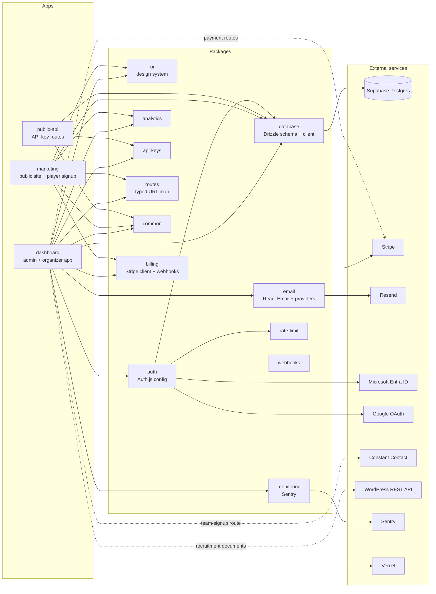

# Architecture

One Turborepo monorepo, three deployable Next.js apps, twelve shared packages, one Postgres database. Apps never import from each other; they share code only through packages, and packages never import from apps.

Solid arrows are workspace imports or the service a package wraps. Dashed arrows are integrations the dashboard app calls directly from a route or data fetcher rather than through a package.

## Apps

**dashboard** is the product. Organizers sign in to buy team slots and tents, see who signed up, and build team and event rosters. Hosts use the `/admin` area of the same app to manage event years, products, coupons, sponsorships, payments, and reports. It also hosts the one public write endpoint, the team-signup API route, which the marketing site posts to.

**marketing** is the public site and the per-organization player signup page at `/on/<slug>`. It fetches the organization's name and logo over a dashboard API route for branding, and every write goes through the dashboard's team-signup route, so the marketing app has no database access of its own.

**public-api** exposes a small set of API-key-authenticated routes for integrations. It shares the database and api-keys packages with the dashboard and nothing else.

## Packages

**ui** is the design system: shadcn/ui components on Radix primitives and Tailwind, copied into the repo so they can be changed freely. It holds about seventy components, from Button to a composed DataTable, chart wrappers, drawers, and the sidebar. Every surface in all three apps is built from it; a table in the admin payments view behaves exactly like the one in an organizer's player list because it is the same component.

**database** owns the Drizzle schema (51 tables), the Postgres client, and the SQL migrations. Every other package and app imports its tables and types from here, so a column rename is one change.

**auth** configures Auth.js: Microsoft Entra ID and Google as OAuth providers, plus credentials with TOTP and recovery codes, backed by the Drizzle adapter so sessions and accounts live in the same database. It also owns the session helpers that server actions call to find the current user and their organization memberships.

**billing** wraps the Stripe client and the subscription-style webhook handling that came with the template. The SportsFest shop's own payment flow (payment intents, deposits, ACH, sponsorship invoices) lives in the dashboard's Stripe routes and uses the same client.

**email** is a provider interface with five implementations (Resend in production; Nodemailer, SendGrid, Postmark, and a console logger), sixteen React Email templates, and one sender function per template.

**monitoring** holds the Sentry configuration for the client, server, and edge runtimes. The admin dashboard's system health card reads issue counts back from the Sentry API.

**rate-limit**, **api-keys**, **routes**, **analytics**, **common**, and **webhooks** are small: an in-memory rate limiter used on sign-in, API key generation and verification, a typed map of every URL in the product (so links are never string-built in components), the analytics provider shim, shared errors and constants, and outbound webhook delivery.

## Patterns worth knowing

**Parallel route slots.** Dashboard pages are composed from Next.js parallel routes: a page like the organizer home has one `@slot` per card or table, each with its own loading and error state, so a slow query for one card never blocks the rest of the page. There are 98 slots across the dashboard.

**Server actions for every mutation.** There are 159 server actions and almost no API routes. Each action validates its input with Zod, checks the session and the caller's permission, runs its database work (in a transaction when more than one table changes), and revalidates the cache tags for the pages that show the result. The team-signup route is the exception, because the marketing app posts to it from another origin.

**Event-year scoping.** Teams, players, products, orders, and reports all hang off an `eventYear` row. Opening 2027 registration the week after the 2026 event meant inserting one row and flipping `isActive`; nothing from 2026 moved.

**Tenant isolation.** Every SportsFest row carries an `organizationId`, and every query in the data layer and every server action filters by the organization the caller belongs to. That is the isolation mechanism. On top of it, the Supabase project has row-level security policies on the same tables, keyed on Supabase Auth's user id. Because the app authenticates with Auth.js and connects through a plain Postgres pool, those policies do not sit in the app's own query path; they protect the Supabase REST surface, as a second lock. The policy file is in `code/packages/database/rls-policies.sql`.

**Admin "view as."** A host can open any organization's dashboard and see exactly what the organizer sees. It works because the organization context is resolved per request from the URL slug and the caller's permissions, not from a stored "current organization."
